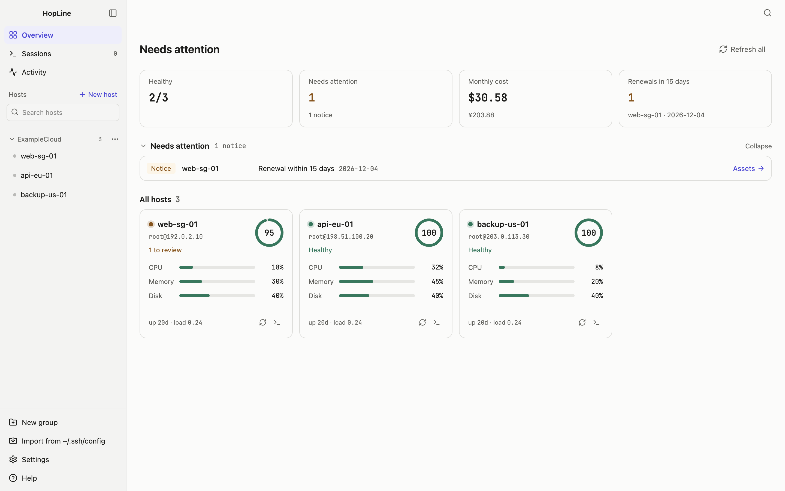
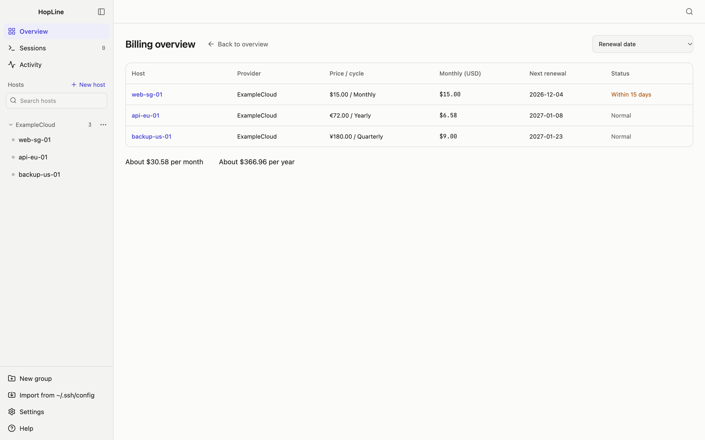
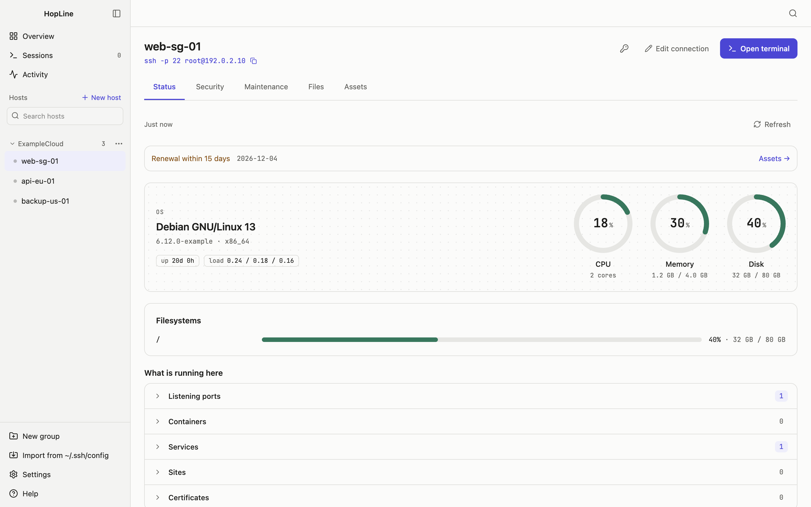

# HopLine

[简体中文](README.md)

**A VPS manager for indie developers: see the health, issues, and renewals of every server at a glance.**

You run a handful of cloud servers. Checking on them means logging in to run `top` and `df`, and renewal dates live in a notes app until one slips past. HopLine puts all of that in one clean desktop app. Connect over SSH and you're done; nothing gets installed on your servers.



## Why HopLine

- **See it at a glance**: How many servers are fine, which one needs attention, what you spend each month, and what renews soon, all on one page.
- **Clean and simple**: No feature pile-up. The terminal and file browser are there when you need them and out of the way when you don't.
- **Your data stays local**: Status is read over SSH with no background process on your servers. Passwords go into the system keychain, and host details stay on your computer.
- **Honest about problems**: Data that can't be read is marked with the reason, never guessed. Maintenance previews its commands before running.

## Features

**Overview and status**
- CPU, memory, disk, load, and uptime, plus what each server runs: ports, containers, services, sites, and certificates.
- While the window is open, the first 5 hosts are collected automatically. Refresh any other host whenever you like.

**Costs and renewals**
- Record the provider, price, and renewal date. Overview totals your monthly cost in CNY and USD.
- Renewals and certificate expiry are flagged 15 days ahead.



**Security and maintenance**
- Security checks with a score, plain explanations, and copyable fix commands.
- A setup wizard for new servers. Every step is previewed, and it confirms your new key works before disabling password or root login, so you don't lock yourself out.
- Disk analysis and cleanup for Docker, system logs, package caches, and old kernels. Unsafe steps are skipped with an explanation.

**Connections and terminal**
- Tabbed SSH terminals, SFTP browsing, and remote editing.
- Password, private-key, and ssh-agent authentication (including 1Password and Secretive), jump hosts, proxies, port forwarding, and `~/.ssh/config` import.
- Paste your provider's welcome email and HopLine fills in the address, port, username, and password.



**Backup**
- Encrypted local backups, with optional upload to your own WebDAV server.

## Install

HopLine is available for Apple Silicon Macs. The app is signed and notarized by Apple.

1. Download `Hopline-…-mac-arm64.zip` from [Releases](https://github.com/dadadasir/HopLine/releases/latest).
2. Unzip it, drag HopLine into **Applications**, and open it.

The first time you open it, macOS may ask for Keychain access, which HopLine uses to store host passwords. Enter your Mac login password and choose **Always Allow**. Use **Help › Check for updates** to get new versions.

## Privacy

- No telemetry and no account.
- The app makes only two requests on its own, neither with host or personal data: a daily update check (can be turned off) and exchange rates once you enter a price.
- Diagnostic bundles are created only when you export one, and are redacted automatically.

## What's next

- The next version plans to support AI coding tools (MCP), so tools like Codex, Claude Code, and Cursor can connect to the hosts you manage in HopLine.
- Only an Apple Silicon Mac build is available for now, and multi-device sync is not supported yet.

## Build from source

You need the Node.js version pinned in [.nvmrc](.nvmrc), plus Xcode Command Line Tools. On Linux, install a C/C++ toolchain and Python 3 instead.

```sh
npm ci
npx --no-install install-electron
npm run dev
```

To package the community edition, run `npm run build:community`; the output goes to `release/`. See [CONTRIBUTING.md](CONTRIBUTING.md) for tests and details.

## Feedback

Report bugs and suggest features through [Issues](https://github.com/dadadasir/HopLine/issues). External code PRs are not accepted for now. Report security vulnerabilities privately as described in [SECURITY.md](SECURITY.md).

## License

[AGPL-3.0-only](LICENSE)
