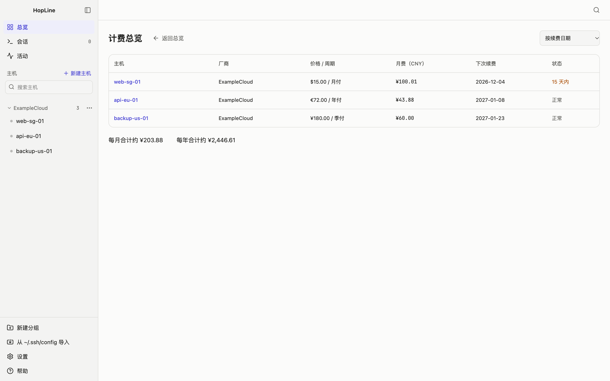

# HopLine

[English](README.en.md)

**给独立开发者的 VPS 管家：一眼看清每台机器的健康、问题和续费。**

手上有几台云服务器，每次都要登上去敲 `top`、`df`，续费日期记在备忘录里，到期了才想起来？HopLine 把这些放进一个干净的桌面应用：连上 SSH 就能看，服务器上不用装任何东西。


## 为什么用 HopLine

- **一眼看清**：几台正常、哪台要处理、每月花多少、谁快到期，总览上直接看到。
- **干净简单**：不堆功能。终端和文件需要时都在，不需要时不打扰。
- **数据留在本机**：只通过 SSH 读取状态，服务器上不留后台进程；密码交给系统钥匙串，主机资料只存在你的电脑上。
- **有一说一**：拿不到的数据会标明原因，不猜测；维护操作先预览命令再执行。

## 主要功能

**总览与状态**
- CPU、内存、磁盘、负载、运行时长，以及机器上在跑什么：端口、容器、服务、站点、证书。
- 窗口开着时自动采集前 5 台主机，其他主机随时手动刷新。

**费用与续费**
- 记录服务商、价格和续费日期，总览汇总每月费用，人民币、美元双币显示。
- 续费和证书到期提前 15 天提醒。



**安全与维护**
- 安全体检：评分、风险说明和可复制的修复命令。
- 新机初始化：每一步先预览，关闭密码或 root 登录前先确认新密钥能登录，避免把自己锁在门外。
- 磁盘分析与清理：Docker、系统日志、包缓存、旧内核等，不安全的步骤会跳过并说明原因。

**连接与终端**
- 多标签 SSH 终端、SFTP 文件浏览、远程编辑。
- 密码、私钥、ssh-agent（支持 1Password、Secretive），跳板机、代理、端口转发，可从 `~/.ssh/config` 导入。
- 粘贴服务商发来的开通信息，自动填好地址、端口、用户名和密码。


**备份**
- 本地加密备份，可选上传到你自己的 WebDAV。

## 安装

目前提供 Apple Silicon Mac（M 系列芯片）版本，安装包已签名并经过 Apple 公证。

1. 到 [Releases](https://github.com/dadadasir/HopLine/releases/latest) 下载 `Hopline-…-mac-arm64.zip`。
2. 解压，把 HopLine 拖进「应用程序」，然后打开。

首次打开时 macOS 可能请求访问钥匙串（用来保存主机密码），输入开机密码并选择「始终允许」即可。之后可在「帮助 › 检查更新」获取新版本。

## 隐私

- 不收集遥测，不需要注册账号。
- 只会主动发出两种请求，都不带主机或个人信息：每天一次检查更新（可关闭），以及填写价格后获取汇率。
- 诊断包只在你手动导出时生成，并自动脱敏。

## 接下来

- 下一版本计划适配 AI 编程工具（MCP），让 Codex、Claude Code、Cursor 等工具能直接连上 HopLine 里的主机。
- 目前只有 Apple Silicon Mac 版本，暂不支持多设备同步。

## 从源码构建

需要 [.nvmrc](.nvmrc) 指定的 Node.js 版本和 Xcode Command Line Tools（Linux 需要 C/C++ 编译工具链和 Python 3）。

```bash
npm ci
npx --no-install install-electron
npm run dev
```

打包开源版：`npm run build:community`，产物在 `release/`。测试与更多说明见 [CONTRIBUTING.md](CONTRIBUTING.md)。

## 反馈

欢迎通过 [Issues](https://github.com/dadadasir/HopLine/issues) 报告问题或提建议，目前不接受外部代码 PR。安全漏洞请按 [SECURITY.md](SECURITY.md) 私下报告。

## 许可证

[AGPL-3.0-only](LICENSE)
