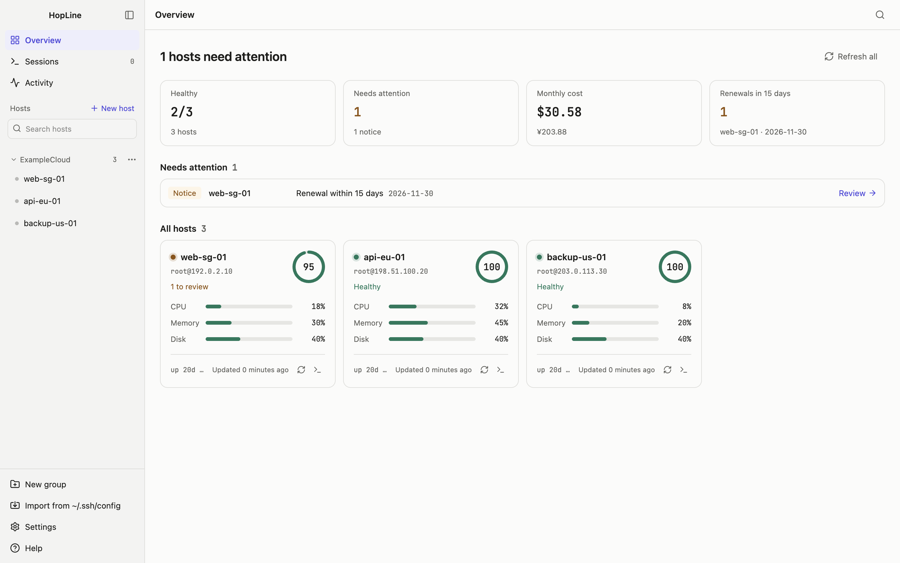
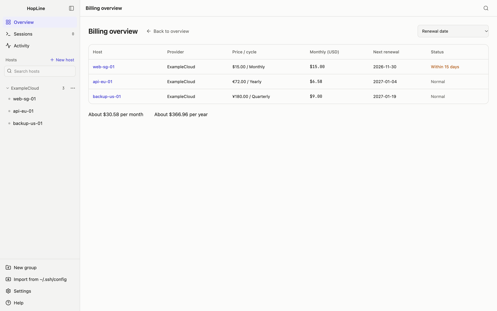
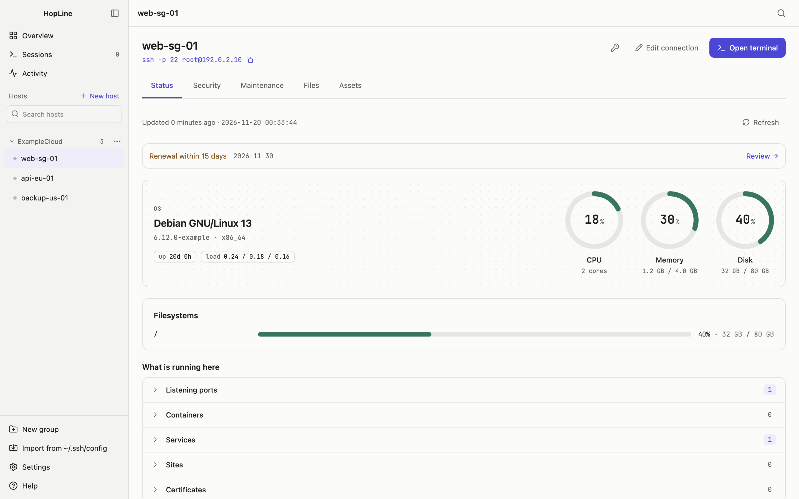

# HopLine

[简体中文](README.zh-CN.md)

**A VPS manager for indie developers: see the health, issues, and renewals of every server at a glance.**

You run a handful of cloud servers. Checking on them means logging in to run `top` and `df`, and renewal dates live in a notes app until one slips past. HopLine puts all of that in one clean desktop app. Connect over SSH and you're done; nothing gets installed on your servers.



## Why HopLine

- **See it at a glance**: Overview tells you how many servers are healthy, which one needs attention, what you spend each month, and what renews in the next 15 days. Status is collected automatically while the window is open, so you don't refresh hosts one by one.
- **Clean and simple**: No feature pile-up. The terminal and file browser are there when you need them and stay out of the way when you don't.
- **No agent, your data stays local**: Status is read over SSH, with no background process left on your servers. Passwords go into the system keychain, and host details stay on your computer.
- **Honest about problems**: Data that can't be read is marked unavailable, with the reason. Nothing is guessed or made up. Maintenance actions preview their commands before running and keep a local record.

## Features

**Overview and status**
- CPU, memory, disk, load, and uptime for each server, plus what it's running: listening ports, containers, services, sites, and certificates.
- While the window is visible, HopLine collects status for the first 5 hosts: every minute in Overview, and every 5 minutes elsewhere by default. Change or turn this off in **Settings → Appearance → Status collection**. You can refresh any host manually from its details.

**Costs and renewals**
- Record the provider, price, billing cycle, and renewal date. Overview totals your monthly cost in both CNY and USD.
- Renewals and certificate expiry are flagged 15 days ahead. For recurring billing, past renewal dates roll forward automatically.



**Security and maintenance**
- Security checks with a score, evidence, and copyable fix commands.
- A setup wizard for new servers. Every step is previewed. Before password or root login is disabled, it checks that your new key can log in. Before the firewall is enabled, it checks that the SSH port is allowed. Both checks keep you from locking yourself out.
- Disk analysis and cleanup for Docker caches and logs, system journals, package caches, and old kernels. Unsafe steps are skipped, with an explanation.

**Connections and terminal**
- Tabbed SSH terminals, SFTP browsing and transfers, and remote editing.
- Password, private-key, and ssh-agent authentication (including 1Password and Secretive), plus jump hosts, proxies, and port forwarding. You can import hosts from `~/.ssh/config`.
- Paste the welcome email from your provider and HopLine fills in the address, port, username, and password.
- Copy the SSH command, or the full connection details (name, note, address, port, username, password), in one click. Copied passwords are cleared from the clipboard after 60 seconds.



**Backup**
- Encrypted local backups and import/export, with optional upload to your own WebDAV server.

## Install

HopLine is currently available for Apple Silicon Macs. The app is signed with a Developer ID and notarized by Apple.

1. Download `Hopline-…-mac-arm64.zip` from [Releases](https://github.com/dadadasir/HopLine/releases/latest).
2. Unzip it, drag HopLine into **Applications**, and open it.

The first time you open it, macOS may ask for Keychain access, which HopLine uses to store host passwords. Enter your Mac login password and choose **Always Allow**.

To verify the download, put the ZIP and `SHA256SUMS.txt` in the same folder and run `shasum -a 256 -c SHA256SUMS.txt`. It should report `OK`.

Use **Help › Check for updates** to look for new versions.

## Privacy

- No telemetry and no account.
- SSH connects directly to the hosts you configure. WebDAV connects to your own server only when you back up.
- The app makes only two requests on its own. Neither one includes host or personal data:
  - **Update check**: at most once a day, to this repository's GitHub Releases. You can turn it off in Settings.
  - **Exchange rates**: at most once a day, using ECB reference rates, and only if you have entered a price.
- Diagnostic bundles are created only when you export one. They are redacted automatically; review them yourself before sharing.

## Known limits

- Only an Apple Silicon Mac build is available for now.
- Automatic collection runs only while the window is visible and stops when you quit.
- Multi-device sync is not available.

## Build from source

You need the Node.js version pinned in [.nvmrc](.nvmrc), plus Xcode Command Line Tools. On Linux, install a C/C++ toolchain and Python 3 instead.

```sh
npm ci
npx --no-install install-electron
npm run dev
```

To package the community edition, run `npm run build:community`; the output goes to `release/`. See [CONTRIBUTING.md](CONTRIBUTING.md) for tests and details.

## Feedback

Report bugs and suggest features through [Issues](https://github.com/dadadasir/HopLine/issues). External code PRs are not accepted for now. Report security vulnerabilities privately as described in [SECURITY.md](SECURITY.md), not in a public issue.

## License

[AGPL-3.0-only](LICENSE)
