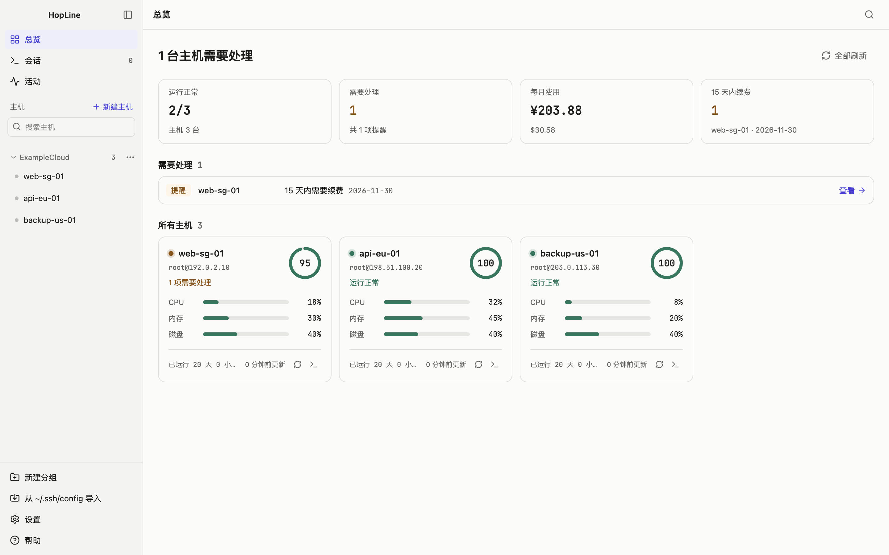
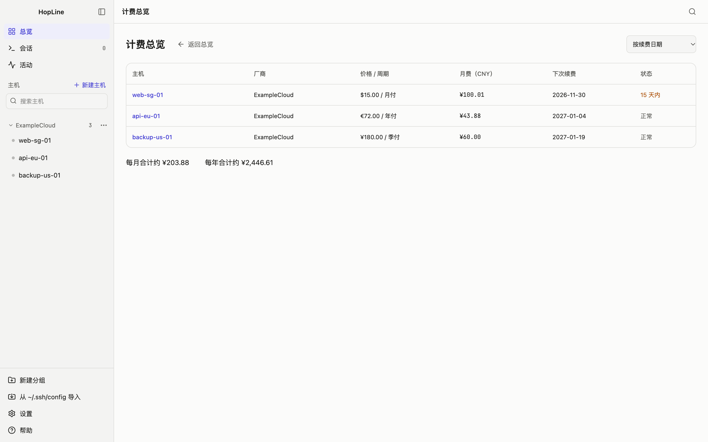
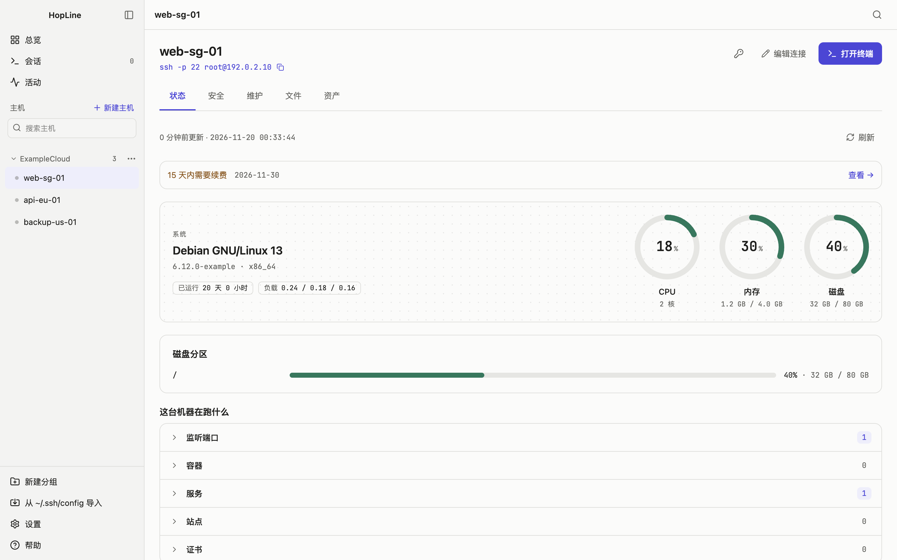

# HopLine

[English](README.md)

**给独立开发者的 VPS 管家：一眼看清每台机器的健康、问题和续费。**

手上有几台云服务器，但每次都要登上去敲 `top`、`df`，续费日期记在备忘录里，到期了才想起来？HopLine 把这些放进一个干净的桌面应用：连上 SSH 就能看，不用在服务器上装任何东西。



## 为什么用 HopLine

- **一眼看清**：总览直接告诉你几台机器正常、哪台需要处理、每月花多少钱、15 天内谁要续费。窗口开着时自动采集，不用一台台点刷新。
- **干净简单**：不堆功能。需要终端和文件时它们都在，不需要时不打扰你。
- **不装 agent，数据留在本机**：只通过 SSH 读取状态，服务器上不留后台进程。密码交给系统钥匙串保管，主机资料只存在你的电脑上。
- **问题说清楚**：拿不到的数据会标明「不可用」和原因，不猜测、不编造。维护操作先预览命令再执行，并留下本地记录。

## 主要功能

**总览与状态**
- 每台机器的 CPU、内存、磁盘、负载、运行时长，以及它在跑什么：监听端口、容器、服务、站点、证书。
- 窗口可见时自动采集前 5 台主机：总览页每分钟一次，其他页面默认每 5 分钟一次，可在「设置 → 外观 → 状态采集」调整或关闭。任何主机都可以在详情页手动刷新。

**费用与续费**
- 记录服务商、价格、计费周期和续费日期；总览汇总每月费用，人民币和美元双币显示。
- 续费和证书到期提前 15 天提醒。按周期付费的机器，过期的续费日会自动顺延显示。



**安全与维护**
- 安全体检：评分、风险证据和可复制的修复命令。
- 新机初始化向导：每一步先预览；关闭密码或 root 登录前先验证新密钥能登录，启用防火墙前先确认 SSH 端口放行，避免把自己锁在门外。
- 磁盘分析与清理：Docker 缓存和日志、系统日志、包缓存、旧内核等，不安全的步骤会跳过并说明原因。

**连接与终端**
- 多标签 SSH 终端、SFTP 文件浏览和传输、远程编辑。
- 密码、私钥、ssh-agent（支持 1Password、Secretive）认证；跳板机、代理、端口转发；可从 `~/.ssh/config` 导入。
- 粘贴服务商发来的开通信息，自动识别地址、端口、用户名和密码。
- 一键复制 SSH 命令或整机连接信息（名称、备注、地址、端口、用户名、密码），复制的密码 60 秒后自动从剪贴板清除。



**备份**
- 本地加密备份、导入导出，可选上传到你自己的 WebDAV。

## 安装

目前提供 Apple Silicon Mac（M 系列芯片）版本。安装包使用 Developer ID 签名并经过 Apple 公证。

1. 到 [Releases](https://github.com/dadadasir/HopLine/releases/latest) 下载 `Hopline-…-mac-arm64.zip`。
2. 解压，把 HopLine 拖进「应用程序」，然后打开。

首次打开时，macOS 可能请求访问钥匙串（用于保存主机密码）。输入开机密码并选择「始终允许」即可。

想校验下载文件的话，把 ZIP 和 `SHA256SUMS.txt` 放在同一目录，运行 `shasum -a 256 -c SHA256SUMS.txt`，结果应显示 `OK`。

之后可在「帮助 › 检查更新」查看新版本。

## 隐私

- 不收集遥测，不需要注册账号。
- SSH 直连你配置的主机；WebDAV 只在你主动备份时连接你自己的服务器。
- 应用只会主动发出两种请求，都不带任何主机或个人信息：
  - 检查更新：每天最多一次，访问本仓库的 GitHub Releases，可在设置里关闭。
  - 汇率：只有填写了价格才会请求，每天最多一次，使用欧洲央行参考汇率。
- 诊断包只在你手动导出时生成，会自动脱敏，分享前请自己再检查一遍。

## 已知限制

- 目前只有 Apple Silicon Mac 安装包。
- 自动采集只在应用窗口可见时进行，退出应用后停止。
- 暂不支持多设备同步。

## 从源码构建

需要 [.nvmrc](.nvmrc) 指定的 Node.js 版本和 Xcode Command Line Tools（Linux 需要 C/C++ 编译工具链和 Python 3）。

```bash
npm ci
npx --no-install install-electron
npm run dev
```

打包开源版：`npm run build:community`，产物在 `release/`。测试与更多说明见 [CONTRIBUTING.md](CONTRIBUTING.md)。

## 反馈

欢迎通过 [Issues](https://github.com/dadadasir/HopLine/issues) 报告问题或提建议。目前不接受外部代码 PR。安全漏洞请按 [SECURITY.md](SECURITY.md) 私密报告，不要公开发 issue。

## 许可证

[AGPL-3.0-only](LICENSE)
